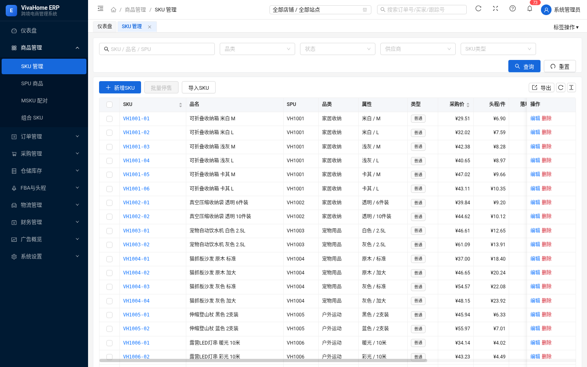
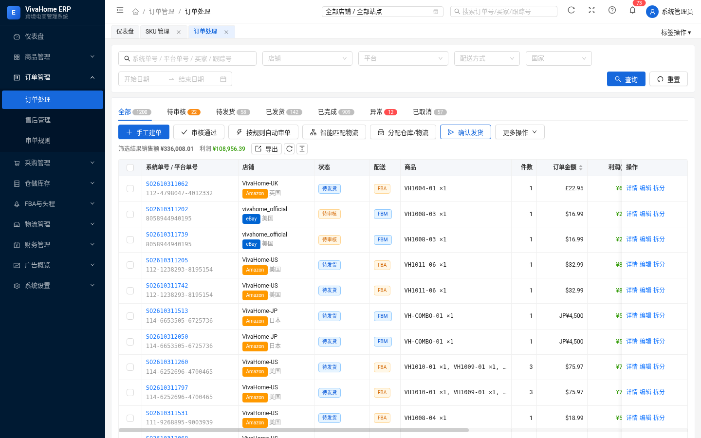

# 跨境电商 ERP（VivaHome ERP）

跨境电商管理系统：覆盖商品、订单、采购、仓储、FBA 头程、物流到财务利润的完整闭环。界面为简体中文的企业后台风格。

## 界面截图


*经营概览 / Dashboard*



*商品 SKU / Product SKUs*



*订单 / Orders*


*财务利润 / Finance / profit*

## 功能特性

- 仪表盘：销售、订单、毛利、广告、库存预警与待办。
- 商品：SKU / SPU / MSKU 配对与组合商品。
- 订单：审单、发货、售后、合并拆分；采购计划与分批收货。
- 仓储库存、FBA 货件、物流与财务利润。
- 左侧分组菜单、多标签页、高密度表格、抽屉详情。

## 技术栈

- 前端：TypeScript + Vite（`web`）
- 后端：TypeScript（`server`，tsx 启动）

## 从源码运行

源码在仓库根目录。本仓库不包含安装包。路径相对于仓库根目录（不要使用文档里可能出现的 `/workspace/erp`）。

```bash
cd server && npm install
cd ../web && npm install && npm run build    # 产物到 web/dist

cd ../server
npx tsx src/seed.ts     # 初始化演示数据（会重建 server/data/erp.db）
npx tsx src/index.ts    # API 与前端静态页共用 8800 端口
```
然后访问 http://localhost:8800 。演示账号：

| 账号 | 密码 | 角色 |
|---|---|---|
| admin | admin123 | 系统管理员 |
| zhangxiao / liwen | 123456 | 运营 |
| zhoucg | 123456 | 采购 |
| liucang | 123456 | 仓管 |
| chencw | 123456 | 财务 |

## 文档

## 贡献

欢迎通过 Issue 和 Pull Request 参与，详见 [CONTRIBUTING.md](CONTRIBUTING.md)。安全问题请按 [SECURITY.md](SECURITY.md) 私下报告。参与时请遵守 [CODE_OF_CONDUCT.md](CODE_OF_CONDUCT.md)。

## 许可证

本仓库尚未附带 LICENSE 文件，许可证未指定。

---

## English

# Cross-border ERP (VivaHome ERP)

A cross-border e-commerce ERP covering products, orders, purchasing, warehousing, FBA inbound, logistics, and profit. The UI is a Simplified-Chinese enterprise back office.

## Screenshots


*经营概览 / Dashboard*


*商品 SKU / Product SKUs*


*订单 / Orders*


*财务利润 / Finance / profit*

## Features

- Dashboard: sales, orders, margin, ads, inventory alerts, and todos.
- Catalog: SKU / SPU / MSKU mapping and bundles.
- Orders: review, ship, after-sales, merge/split; purchase plans and partial receiving.
- Warehouse stock, FBA shipments, logistics, and profit.
- Grouped sidebar, multi-tabs, dense tables, and detail drawers.

## Tech stack

- 前端：TypeScript + Vite（`web`）
- 后端：TypeScript（`server`，tsx 启动）

## Getting started

Source is at the repository root. This repository does not include installers. Paths are relative to the repository root (ignore any `/workspace/erp` prefixes in older notes).

```bash
cd server && npm install
cd ../web && npm install && npm run build    # output in web/dist

cd ../server
npx tsx src/seed.ts     # seeds demo data (rebuilds server/data/erp.db)
npx tsx src/index.ts    # API and static UI share port 8800
```
Open http://localhost:8800 . Demo accounts:

| Account | Password | Role |
|---|---|---|
| admin | admin123 | administrator |
| zhangxiao / liwen | 123456 | operations |
| zhoucg | 123456 | purchasing |
| liucang | 123456 | warehouse |
| chencw | 123456 | finance |

## Documentation

## Contributing

Issues and pull requests are welcome. See [CONTRIBUTING.md](CONTRIBUTING.md). Please report vulnerabilities privately via [SECURITY.md](SECURITY.md). This project follows [CODE_OF_CONDUCT.md](CODE_OF_CONDUCT.md).

## License

No LICENSE file is included in this repository; the license is unspecified.
